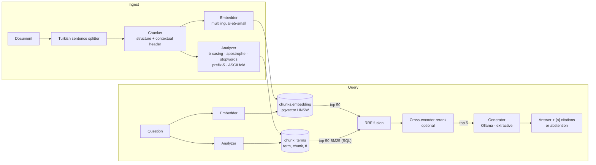
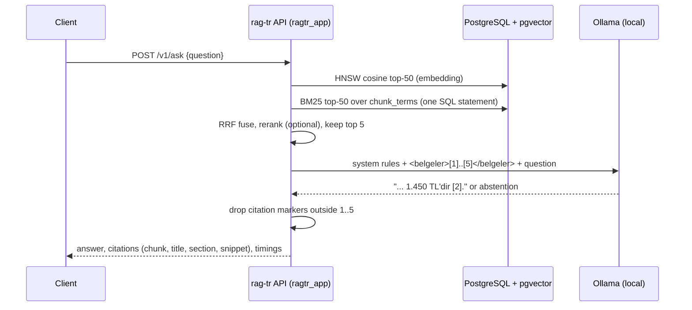

# rag-tr

[](https://github.com/hekimcan206/rag-tr/actions/workflows/ci.yml)
[](https://github.com/hekimcan206/rag-tr/actions/workflows/codeql.yml)

[](LICENSE)

Retrieval-augmented question answering over **Turkish** documents. It covers Turkish-aware text processing and
chunking, hybrid search (pgvector + BM25 computed in PostgreSQL), and cited answers from a local LLM that says
it does not know when the documents do not say. It comes with a reproducible evaluation set and the numbers
behind every design choice.

> All data is synthetic: fictional municipalities, companies and appliances. There is no real personal data.

## The problem

Most RAG tutorials are English, and the defaults quietly fail on Turkish:

- `"IŞIKLIOVA".lower()` is `"işikliova"`, not `"ışıklıova"`. Python's casing is not Turkish, so BM25 misses
  capitalised names.
- `Işıklıova'da`, `Işıklıova'nın` and `Işıklıova'ya` are three different tokens unless the apostrophe suffix is handled.
- A noun has dozens of inflected forms, and a paraphrased question rarely uses the document's exact inflection.
- People type `isikliova nikah ucreti` without Turkish letters.
- `3. kat` and `Dr. Ayşe` contain periods that are not sentence ends, so naive splitters cut sentences in half.
- Institutional documents come in **near-duplicate families**: every municipality publishes the same "water
  subscription guide" with different numbers. Retrieval must find the right *entity*, not just the right topic.
  A wrong town's deposit amount, cited confidently, is worse than no answer.

A RAG system without numbers is a demo. This repository measures each of these problems and each fix.

## What it does

Real output from the default, download-free stack (hashing embedder, extractive answers):

```text
$ ragtr ingest data
ingested 59 documents, 191 chunks

$ ragtr ask "Işıklıova Belediyesi'nde su aboneliği için güvence bedeli ne kadar?"
Yeni konut aboneliklerinde 2.450 TL güvence bedeli alınır. [1]
  [1] Işıklıova Belediyesi Su Aboneliği Rehberi > Ücretler  (isikliova-su-aboneligi#0002)

$ ragtr ask "isikliova nikah hafta sonu ucreti"          # typed without Turkish letters
Hafta içi yapılan nikâhlar için 550 TL, hafta sonu ve resmî tatil günlerinde yapılan nikâhlar için 1.100 TL ücret alınır. [1]
  [1] Işıklıova Belediyesi Nikâh İşlemleri > Ücretler  (isikliova-nikah-islemleri#0002)

$ ragtr ask "Yeşilvadi Belediyesi'nde otopark aylık abonman ücreti ne kadardır?"   # no document covers this
Belgelerde bu sorunun yanıtı yok.
```

The same question to gemma3:4b through Ollama (`RAGTR_GENERATOR=ollama`) returned
`Işıklıova Belediyesi'nde yeni konut aboneliklerinde 2.450 TL güvence bedeli alınır [1].`

- **Ingest** Markdown or plain text over HTTP (`PUT /v1/documents/{id}`, idempotent re-ingest).
- **Search** in `bm25`, `dense` or `hybrid` mode, with an optional cross-encoder rerank (`POST /v1/search`).
- **Ask**: an answer in Turkish with `[n]` citations that link to the exact chunks, or a fixed abstention
  sentence (`POST /v1/ask`).
- **Evaluate**: `ragtr eval --suite main|chunking|normalisation|embedders|generation|ci`.

## Architecture





## Why this design

| Decision | Alternatives | Why | ADR |
|---|---|---|---|
| Turkish analyser: locale casing, apostrophe suffixes, **prefix-5** stems, ASCII folding | `str.lower`, Snowball, Zemberek | Measured ladder: BM25 R@5 rises from 0.837 to 0.955. Prefix-5 beat Snowball (0.955 vs 0.932; paraphrases 0.866 vs 0.796) | [0001](docs/adr/0001-turkish-lexical-normalisation.md) |
| Section-bounded chunks with a `Title > Section` header | fixed window, sentence packing, sections without header | Best recall at equal context cost (R@300w). Without the header, small chunks lose the entity name (R@1 0.147) | [0002](docs/adr/0002-structure-aware-chunking-with-contextual-headers.md) |
| One PostgreSQL: pgvector HNSW + BM25 in SQL + RRF | OpenSearch + a vector DB; `tsvector`/`ts_rank` | One transactional store. `ts_rank` is not BM25, and PostgreSQL's `turkish` config lowercases `I` to `i`. SQL BM25 equals the reference implementation to 1e-9 | [0003](docs/adr/0003-hybrid-retrieval-in-postgresql.md) |
| Local LLM via Ollama, numbered citations, mandatory abstention; evaluation without an LLM judge | hosted API; LLM-as-judge | No document leaves the host, answers are checkable, and metrics are deterministic and cheap enough for CI | [0004](docs/adr/0004-local-generation-citations-and-evaluation.md) |

## Results

Measured on the committed synthetic set: 59 documents about 15 fictional entities (5 municipalities,
4 companies, 6 appliance models). Each entity has the same document types with different values. There are 602 questions:
186 facts × 3 phrasings plus 44 unanswerable questions.

- **canonical**: formal, close to the document wording;
- **paraphrase**: different vocabulary and inflection (`güvence bedeli` → `depozito`);
- **ascii**: lowercased, without Turkish letters (`isikliova belediyesinde ...`).

A chunk is relevant when it comes from the gold document and contains the gold answer span, so relevance is
mechanical, with no human labelling. R@300w asks whether the answer is inside the top chunks that fit in 300
words (see ADR 0002). Full tables, method and environment: [docs/evaluation.md](docs/evaluation.md).

**Retrieval: mode × reranker** (multilingual-e5-small, structure+context chunks, Turkish analyser,
`mmarco-mMiniLMv2-L12` cross-encoder on the top 20; 558 answerable questions):

| run | R@1 | R@5 | MRR@10 | nDCG@10 | R@5 paraphrase | R@5 ascii |
|---|---|---|---|---|---|---|
| BM25 (Turkish analyser) | 0.701 | 0.955 | 0.802 | 0.848 | 0.866 | 1.000 |
| dense (e5-small) | 0.828 | 0.996 | 0.906 | 0.930 | 0.989 | 1.000 |
| hybrid (RRF) | 0.776 | **0.998** | 0.870 | 0.903 | 0.995 | 1.000 |
| hybrid + rerank | **0.961** | **1.000** | **0.980** | **0.985** | 1.000 | 1.000 |

BM25 + rerank and dense + rerank score the same as hybrid + rerank here: all three first stages put the answer
in the top 20, so the cross-encoder decides the order.

**Answers** (contexts from hybrid + rerank, top 5; all 602 questions):

| generator | n | accuracy | citation precision | groundedness | false abstention | abstention on unanswerable |
|---|---|---|---|---|---|---|
| extractive (no LLM) | 602 | 0.473 | 1.000 | 1.000 | 0.525 | 1.000 (44/44) |
| gemma3:4b via Ollama | – | not measured: see [Limitations](#limitations-and-next-steps) | | | | |

**Embedders, dense retrieval alone:**

| embedder | R@1 | R@5 | MRR@10 | R@5 paraphrase | R@5 ascii |
|---|---|---|---|---|---|
| hashing-384 (no model, baseline) | 0.489 | 0.797 | 0.615 | 0.677 | 0.860 |
| paraphrase-multilingual-MiniLM-L12-v2 | 0.441 | 0.817 | 0.593 | 0.882 | 0.624 |
| multilingual-e5-small | 0.828 | 0.996 | 0.906 | 0.989 | 1.000 |
| multilingual-e5-base | 0.846 | 0.995 | 0.913 | 1.000 | 0.984 |

What the numbers say:

1. **Turkish normalisation matters most for lexical search.** BM25 R@5 rises from 0.837 (`str.lower`) to 0.955, paraphrase
   R@5 from 0.581 to 0.866, and ASCII-typed R@5 from 0.935 to 1.000. Stemming gives the largest step and ASCII folding the
   second. Inside hybrid search the Turkish analyser lifts R@1 from 0.663 to 0.776.
2. **Without the contextual header, small chunks fail on near-duplicates.** Section chunks without the
   `Title > Section` header reach R@1 0.12–0.16 in every mode; with the header they reach 0.70 (BM25) to 0.83 (dense).
   At equal context cost (R@300w) structure+context beats fixed windows and sentence packing (1.000 vs 0.962 / 0.968 with E5).
3. **The cross-encoder is the biggest single gain on ranking.** Hybrid R@1 goes from 0.776 to 0.961 and MRR from 0.870 to 0.980,
   for about 0.55 s per question on CPU (20 candidates, 27 ms per pair).
4. **Hybrid is not a free win.** It has the best first-stage recall (R@5 0.998), but dense E5 alone ranks the right chunk
   first more often (R@1 0.828 vs 0.776). With the download-free hashing embedder, BM25 alone wins. Hybrid stays the
   default because it is never the worst of the three, whatever the embedder, and the reranker removes the R@1 gap.
5. **Model choice:** multilingual-e5-small matches e5-base at a third of the size; paraphrase-multilingual-MiniLM is worse
   than the no-model hashing baseline on R@1 and on ASCII-typed questions.
6. **The extractive baseline never invents and refuses too often.** Every citation points at the gold chunk, and all 44
   unanswerable questions are refused. But 52.5% of answerable questions are also refused, because it can only answer when
   a single sentence covers the question. Closing that gap is the LLM's job. Its accuracy is not measured yet (see Limitations).

## Quick start

```bash
docker compose up            # PostgreSQL + pgvector, migrate, API on :58470, indexes the corpus
curl -s localhost:58470/v1/ask -H 'content-type: application/json' \
     -d '{"question":"Akçaburç Belediyesi'"'"'nde hacimli atıklar ayda kaç kez ücretsiz alınır?"}' | jq
```

The default stack is deterministic and downloads no model (hashing embedder, extractive answers), so it starts
in seconds and CI can assert on it. For the real stack, copy `.env.example` to `.env`, uncomment the ML block
(E5 embedder, cross-encoder, Ollama), then run:

```bash
docker compose --profile llm up --build
```

Local development (Python 3.13, [uv](https://docs.astral.sh/uv/)):

```bash
uv sync --extra ml           # CPU-only PyTorch
uv run pytest                # unit + Testcontainers integration + evaluation regression gate
uv run ragtr eval --suite main --embedder e5-small --reranker mmarco-minilm
```

OpenAPI docs: `http://localhost:58470/docs`.

## Testing

131 tests (116 unit and API, 15 integration) pass locally and in CI, with 91% line and branch coverage of `src/ragtr`.

- **Unit tests** cover Turkish casing and folding (with Hypothesis properties), sentence-splitter golden cases,
  chunk offsets, BM25 and RRF, retrieval on near-duplicates, citation parsing, metrics, the generator against a
  mocked Ollama, and API validation.
- **Integration tests** (Testcontainers, `pgvector/pgvector:0.8.1-pg17`) check that SQL BM25 equals the in-memory reference,
  that HNSW agrees with exact search at the top, atomic re-ingest, that a failed ingest keeps the old version, that the app role
  cannot run DDL, and the analyser/embedder mismatch guard.
- **Evaluation regression gate**: CI re-runs the download-free `ci` suite and fails if any metric differs from
  [`eval/results/ci.json`](eval/results/ci.json). A tokenisation or chunking change has to show its effect.
- **Compose demo in CI**: `docker compose up`, then ask, search with ASCII input, check abstention, re-seed idempotently, and confirm the
  app role is denied `DROP TABLE`.

## Limitations and next steps

- **Synthetic, small, and easy for strong embedders.** There are 191 chunks, and E5 reaches R@5 ≈ 0.996, so R@1, MRR and
  the weak-embedder runs carry the signal. The next step is a public Turkish QA set and a corpus big enough for
  approximate (HNSW) recall to matter.
- **Fusion is untuned.** Equal-weight RRF trails dense-only on R@1 with a strong embedder. A weighted or learned fusion
  should be tuned on a held-out split, never on this evaluation set.
- **No LLM answer metrics yet.** The `generation` suite (gemma3:4b on Ollama, CPU) is implemented, but it never completed on
  the development machine: the model runner was killed for memory in a 7.6 GB Docker VM shared with other workloads. Spot
  checks returned a correctly cited fee and a correct abstention. Those are anecdotes, not measurements. The next step is a
  run on a machine with enough memory (or a GPU), reported next to the extractive baseline.
- **Groundedness is lexical.** It catches invented numbers and names, not a wrong paraphrase built from context words.
  An NLI or LLM judge, calibrated against hand labels, would be the upgrade.
- **Prefix-5 stemming** over-conflates on large vocabularies. A morphological analyser (Zemberek) is the
  accurate option.
- No authentication, tenancy or document-level ACLs. See [SECURITY.md](SECURITY.md) and the
  [threat model](docs/threat-model.md).

## Privacy (KVKK)

KVKK (Kişisel Verilerin Korunması Kanunu, Law No. 6698) is Turkey's personal data protection law. This
repository contains no personal data. In a real deployment, these design choices matter: generation runs locally
(Ollama), so documents and questions are not sent to a third-party model provider; questions and answers are not logged;
and `DELETE /v1/documents/{id}` removes a document's chunks, vectors and terms in one transaction.
Indexing documents that contain personal data would still need a legal basis and a retention policy.

## License

[MIT](LICENSE)
