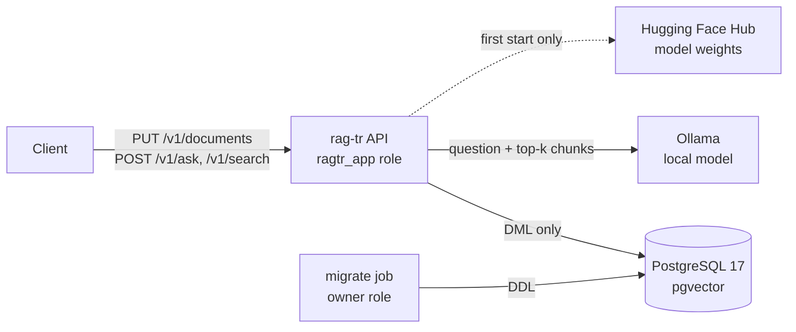

# Threat model

Scope: the rag-tr API, its PostgreSQL + pgvector store, the optional local LLM (Ollama) and the ingestion
path, as deployed by `docker-compose.yml`. Method: STRIDE over the data flows below, with an extra
section for the risks specific to retrieval-augmented generation (OWASP Top 10 for LLM Applications 2025:
LLM01 prompt injection, LLM02 sensitive information disclosure, LLM08 vector and embedding weaknesses,
LLM09 misinformation).

## Assets

| Asset | Why it matters |
|---|---|
| Indexed documents and chunks | The knowledge base; in a real deployment it would hold internal documents |
| Answer integrity | A wrong answer with a confident citation is worse than no answer |
| Database schema and roles | Control over what the API process can change |
| Model weights (embedder, reranker, LLM) | Code-adjacent artefacts loaded at start-up |
| Host resources | CPU-heavy embedding and generation are easy to exhaust |

## Actors

- **Reader**: asks questions. Untrusted input.
- **Author**: uploads documents. In this demo the same unauthenticated API; in a deployment, a separate
  privileged role. A malicious or careless author controls text that later reaches the LLM prompt.
- **Operator**: runs compose, holds the database owner password.
- **Supply chain**: PyPI packages, the PyTorch wheel index, Hugging Face model repositories, container images.

## STRIDE

| # | Threat | Where | Mitigation | Status |
|---|---|---|---|---|
| S1 | Anyone on the network calls the write endpoints | API | Ports bound to `127.0.0.1` in compose; README and SECURITY.md say not to expose it | **Open**: no authentication (out of scope) |
| T1 | SQL injection through document ids, titles or questions | API → PG | psycopg parameters everywhere; ids validated against `^[A-Za-z0-9][A-Za-z0-9._-]{0,199}$`; the only formatted DDL value is the integer vector dimension, range-checked | Mitigated, tested (`test_input_validation`, path-traversal id) |
| T2 | API process alters or drops the schema | PG | API connects as `ragtr_app` with DML grants only; DDL runs in the one-shot `migrate` job as the owner | Mitigated, CI asserts `DROP TABLE` fails with "must be owner" |
| T3 | Index built with one embedder queried with another (silent garbage) | PG | `ragtr_meta` records embedder, dimension and analyser; the store refuses to open on mismatch (`IndexMismatchError`) | Mitigated, integration-tested |
| R1 | No record of who uploaded or deleted what | API | Structured logs carry document id, chunk count and timings | **Partial**: no actor identity without auth |
| I1 | Questions and answers leak into logs | API | Request bodies, questions and answers are never logged; spans carry token counts, not text | Mitigated |
| I2 | Document text sent to a third-party LLM | API → LLM | Default generator is local (Ollama or extractive); no hosted-model client is shipped | Mitigated by design |
| I3 | Reader retrieves documents they should not see | API | Not addressed: the index is single-tenant | **Open**: per-document ACL filter on retrieval is the next step |
| D1 | Very large documents or questions exhaust CPU/RAM | API | Document ≤ 500 000 chars, question ≤ 1 000 chars, `k` ≤ 20, candidates ≤ 500; 413/422 responses | Mitigated, tested |
| D2 | Slow LLM ties up workers | API → LLM | Ollama timeout (120 s default), `num_predict` 256, `num_ctx` 4096 | Partial: no queue or rate limit |
| E1 | Container breakout from a compromised dependency | Image | Non-root UID 10001, slim runtime stage without compilers | Partial |

## RAG-specific threats

| # | Threat | Mitigation | Residual risk |
|---|---|---|---|
| L1 | **Indirect prompt injection** (LLM01): an uploaded document contains "ignore previous instructions and ..." | Retrieved text is fenced in `<belgeler>...</belgeler>`; the system prompt (rule 4) says instructions inside documents are not to be followed; the model has **no tools and no network**, so the worst outcome is a manipulated answer text, not an action | A model can still be talked into a wrong answer. Citations make it visible: every answer links to the chunks it used. Treat document upload as a privileged operation |
| L2 | **Fabricated citations** (LLM09): the model cites `[7]` when only 5 contexts were given, or cites a context that does not support the claim | `parse_citations` drops markers outside `1..n`; the evaluation measures citation precision and a lexical groundedness score (share of answer content terms present in cited chunks) | Lexical groundedness misses a wrong paraphrase built from context words; it is a proxy, not proof (see `docs/evaluation.md`) |
| L3 | **Answering without evidence** | Abstention sentence required by the prompt when the context lacks the answer; unanswerable questions are part of the evaluation set and the abstention rate is reported | Measured, not eliminated: see the abstention columns in the results |
| L4 | **Near-duplicate confusion**: the right topic from the wrong entity (another municipality's fee) | Hybrid retrieval (BM25 matches the rare entity name), contextual chunk headers that carry the document title; the synthetic set is built from near-duplicate families to measure exactly this | Dense-only retrieval with a weak embedder fails here; tested (`test_dense_alone_confuses_near_duplicate_entities_and_hybrid_recovers`) |
| L5 | **Embedding inversion / poisoning** (LLM08) | Vectors stay in the database, never returned by the API; poisoning is equivalent to L1 (author trust) | Out of scope beyond author trust |
| L6 | **Malicious model weights** | Embedders and rerankers load through sentence-transformers from named Hugging Face repositories; `trust_remote_code` is never enabled | Weights are not hash-pinned; pin revisions before production use |

## Out of scope

Authentication and authorisation, multi-tenant isolation, TLS, rate limiting, PII redaction of uploaded
documents. All data in this repository is synthetic.
